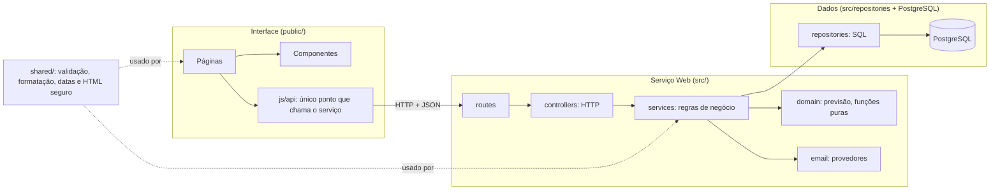
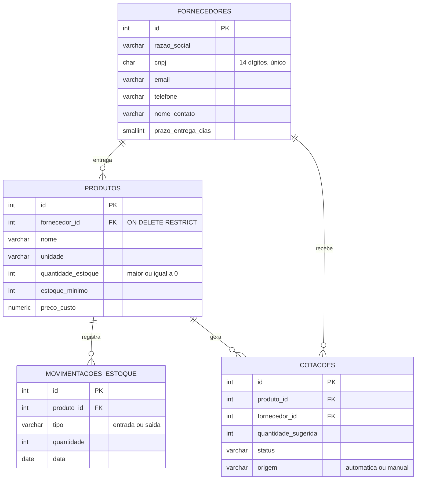
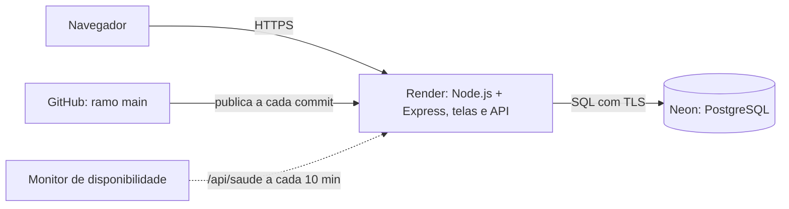

# Mercadinho São José

Plataforma Web do **Mercadinho São José**, desenvolvida para o Cenário 6 do trabalho da disciplina **N695 Desenvolvimento de Plataformas Web** (Universidade de Fortaleza, 2026). Cadastra fornecedores e os produtos que cada um entrega, prevê quando cada produto vai acabar, mostra a sazonalidade das vendas e pede cotação ao fornecedor por e-mail, sozinha, quando o estoque chega ao mínimo.

- **Aplicação publicada:** https://SEU-SERVICO.onrender.com *(a equipe preenche depois de publicar)*
- **Repositório:** https://github.com/SEU-USUARIO/mercadinho-sao-jose *(a equipe preenche)*
- **Acesso para avaliação:** usuário `avaliacao` e senha `mercadinho2026` (também aparecem na tela de login)

> **O problema do cenário:** o mercadinho compra de cerca de 15 fornecedores, descobre que um produto acabou apenas quando o cliente pergunta por ele e, na hora de repor, ninguém lembra de quem aquele item foi comprado.

## Sumário

1. [O que o sistema faz](#o-que-o-sistema-faz)
2. [Tecnologias](#tecnologias)
3. [Arquitetura em camadas](#arquitetura-em-camadas)
4. [Modelo de dados](#modelo-de-dados)
5. [API REST](#api-rest)
6. [Validação e tratamento de erros](#validação-e-tratamento-de-erros)
7. [Clean code: onde ver cada prática](#clean-code-onde-ver-cada-prática)
8. [Como a previsão funciona](#como-a-previsão-funciona)
9. [Como rodar no seu computador](#como-rodar-no-seu-computador)
10. [Como publicar (Render + Neon)](#como-publicar-render--neon)
11. [Envio de e-mail](#envio-de-e-mail)
12. [Roteiro para as capturas do relatório](#roteiro-para-as-capturas-do-relatório)
13. [Testes, segurança e limitações](#testes-automatizados)

## O que o sistema faz

### Requisitos do cenário

| Requisito | Onde está |
|---|---|
| Entidades **Fornecedor** e **Produto** (um fornecedor entrega vários produtos; cada produto pertence a um fornecedor) | [`src/database/schema.sql`](src/database/schema.sql) |
| Criar, listar, atualizar e excluir as duas entidades por um **serviço Web próprio** | [`src/routes`](src/routes), [`src/controllers`](src/controllers), [`src/services`](src/services) |
| Tela mínima 1: **lista de fornecedores** | `#/fornecedores`: [`listaDeFornecedores.js`](public/js/paginas/listaDeFornecedores.js) |
| Tela mínima 2: **cadastro/edição de fornecedor** | `#/fornecedores/novo` e `#/fornecedores/:id/editar`: [`formularioDeFornecedor.js`](public/js/paginas/formularioDeFornecedor.js) |
| Tela mínima 3: **lista de produtos de um fornecedor com cadastro/edição** | `#/fornecedores/:id/produtos`, `.../produtos/novo` e `#/produtos/:id/editar`: [`produtosDoFornecedor.js`](public/js/paginas/produtosDoFornecedor.js), [`formularioDeProduto.js`](public/js/paginas/formularioDeProduto.js) |
| Regra: campos obrigatórios | [`shared/validacao.js`](shared/validacao.js) |
| Regra: CNPJ com 14 dígitos | `cnpjCom14Digitos` em [`shared/validacao.js`](shared/validacao.js) + restrição no banco |
| Regra: quantidade em estoque não negativa | `naoNegativo` em [`shared/validacao.js`](shared/validacao.js) + restrição no banco |
| Regra: impedir exclusão de fornecedor que ainda tenha produtos | `excluirFornecedor` em [`fornecedorService.js`](src/services/fornecedorService.js) + chave estrangeira `ON DELETE RESTRICT` |
| Persistência em **banco de dados** | PostgreSQL no [Neon](https://neon.com), com as tabelas criadas pelo próprio sistema ao subir |

### Funcionalidades adicionais

1. **Previsão de quando o produto vai acabar.** Usa as vendas dos últimos 30 dias, ajustadas pela sazonalidade, e simula o estoque dia a dia. Classifica cada produto como *esgotado*, *no mínimo*, *pedir já* (acaba antes de a entrega do fornecedor chegar) ou *em dia*, e sugere quanto comprar.
2. **Sazonalidade de produtos.** Calcula, a partir do histórico, quanto cada produto vende em cada mês em relação à média do ano. O painel avisa o que entra em alta temporada no mês seguinte, e há um mapa de calor com todos os produtos.
3. **Cotação automática por e-mail.** Quando uma movimentação leva o estoque ao mínimo, o sistema envia ao fornecedor um pedido de cotação com a quantidade sugerida e o prazo desejado. Nunca há duas cotações abertas para o mesmo produto, e a cotação é encerrada sozinha quando o estoque é reposto. O envio por WhatsApp fica para a versão 2.
4. **Login e senha.** Só quem entra no sistema vê as telas e usa a API. A senha é guardada com hash (scrypt), a sessão fica num cookie protegido e há limite de tentativas erradas. Os detalhes estão em [Segurança](#segurança).

## Tecnologias

| Camada | Tecnologia | Por que foi escolhida |
|---|---|---|
| Interface | HTML, CSS e JavaScript puro (módulos ES), sem framework | Mostra diretamente os fundamentos dos percursos 1 e 2, sem etapa de build |
| Serviço Web | Node.js 22+ e Express 5 | Express 5 encaminha erros de funções `async` ao tratador central sem código extra |
| Banco de dados | PostgreSQL, acessado com `pg` (SQL parametrizado) | Banco relacional com restrições (`CHECK`, `UNIQUE`, `FOREIGN KEY`) que reforçam as regras |
| Segurança | `helmet` (cabeçalhos e CSP) e `express-rate-limit` | Proteções padrão do ecossistema Express |
| E-mail | API HTTP da Brevo, ou SMTP com `nodemailer` | O plano gratuito do Render bloqueia as portas SMTP; a API HTTP (HTTPS) funciona |
| Hospedagem | [Render](https://render.com) (serviço Web) e [Neon](https://neon.com) (PostgreSQL), ambos no plano gratuito e no Leste dos EUA | Publicação automática a cada commit, HTTPS pronto e um banco que não expira (o Postgres gratuito do próprio Render expira em 30 dias) |
| Testes | `node:test`, que já vem no Node | Nenhuma dependência extra |

## Arquitetura em camadas



Cada camada só conversa com a vizinha. A interface não conhece o banco, e os controladores não contêm regras de negócio. Só os repositórios escrevem SQL. A pasta `shared/` é servida ao navegador e também importada pelo Node: assim, as regras de validação são escritas uma única vez.

```
mercadinho-sao-jose/
├── public/                  Interface (HTML, CSS, JavaScript)
│   ├── index.html
│   ├── css/estilos.css
│   ├── fonts/               Fontes hospedadas no próprio projeto (licença OFL)
│   └── js/
│       ├── main.js          Registra as telas
│       ├── roteador.js      Navegação entre telas (#/...)
│       ├── api/             Chamadas ao serviço Web
│       ├── componentes/     Formulários, gráficos, diálogos, avisos
│       └── paginas/         Uma tela por arquivo
├── shared/                  Código usado pela interface e pelo serviço
├── src/
│   ├── server.js            Ponto de entrada
│   ├── app.js               Montagem do Express
│   ├── config/              Variáveis de ambiente
│   ├── routes/              URLs da API
│   ├── controllers/         Camada HTTP
│   ├── services/            Regras de negócio
│   ├── domain/              Previsão e sazonalidade (funções puras)
│   ├── repositories/        Acesso a dados (SQL)
│   ├── database/            Conexão, estrutura (schema.sql) e dados de demonstração
│   ├── email/               Modelo do e-mail e provedores de envio
│   ├── errors/              Erros da aplicação
│   ├── seguranca/           Senhas (scrypt) e cookie da sessão
│   └── middlewares/         Login obrigatório e tratamento central de erros
├── scripts/                 Comandos para criar e popular o banco
└── tests/                   Testes automatizados
```

## Modelo de dados



As duas entidades do cenário são `fornecedores` e `produtos`. As tabelas de movimentações e cotações sustentam as funcionalidades adicionais. Um índice único parcial garante no máximo uma cotação em aberto por produto.

## API REST

Todas as rotas começam em `/api` e trocam JSON. Erros sempre têm o formato `{ "mensagem": "...", "erros": { "campo": "..." } }`.

| Método | Rota | O que faz | Sucesso |
|---|---|---|---|
| GET | `/fornecedores?busca=` | Lista fornecedores (busca por nome, contato ou CNPJ) | 200 |
| POST | `/fornecedores` | Cria fornecedor | 201 |
| GET | `/fornecedores/:id` | Busca um fornecedor | 200 |
| PUT | `/fornecedores/:id` | Atualiza fornecedor | 200 |
| DELETE | `/fornecedores/:id` | Exclui (recusa com 409 se houver produtos) | 204 |
| GET | `/fornecedores/:id/produtos` | Produtos do fornecedor, com previsão | 200 |
| GET | `/produtos` | Lista todos os produtos, com previsão | 200 |
| POST | `/produtos` | Cria produto (pode disparar cotação) | 201 |
| GET | `/produtos/:id` | Busca um produto | 200 |
| PUT | `/produtos/:id` | Atualiza produto (pode disparar cotação) | 200 |
| DELETE | `/produtos/:id` | Exclui produto e seu histórico | 204 |
| GET | `/produtos/:id/previsao` | Previsão completa e curva de 60 dias | 200 |
| GET | `/produtos/:id/movimentacoes` | Últimas 30 entradas e saídas | 200 |
| POST | `/produtos/:id/movimentacoes` | Registra entrada ou saída (pode disparar cotação) | 201 |
| POST | `/produtos/:id/cotacoes` | Pede cotação manualmente | 201 |
| GET | `/cotacoes?situacao=abertas\|todas&produtoId=` | Lista cotações | 200 |
| GET | `/cotacoes/:id` | Busca cotação, com o texto do e-mail | 200 |
| PATCH | `/cotacoes/:id` | Conclui ou cancela: `{ "status": "concluida" }` | 200 |
| POST | `/cotacoes/:id/reenvio` | Reenvia o e-mail | 200 |
| GET | `/painel` | Dados do painel | 200 |
| GET | `/sazonalidade` | Índices sazonais de todos os produtos | 200 |
| GET | `/saude` | Verificação de funcionamento (pública; não consulta o banco) | 200 |
| GET | `/sessao` | Diz se há alguém logado (pública) | 200 |
| POST | `/sessao` | Entra no sistema: `{ "usuario": "...", "senha": "..." }`; devolve o cookie da sessão (pública) | 200 |
| DELETE | `/sessao` | Sai do sistema e apaga a sessão no servidor | 204 |

Todas as rotas, menos `/saude` e `/sessao`, exigem login: sem sessão válida, a resposta é `401`.

Exemplos de requisição (troque o endereço pelo da aplicação publicada):

```bash
# 1. Entrar: o cookie da sessão fica guardado no arquivo cookies.txt
curl -c cookies.txt -X POST https://SEU-SERVICO.onrender.com/api/sessao \
  -H "Content-Type: application/json" \
  -d '{"usuario":"avaliacao","senha":"mercadinho2026"}'

# 2. Usar a API com a sessão (-b envia o cookie)
curl -b cookies.txt https://SEU-SERVICO.onrender.com/api/fornecedores

curl -b cookies.txt -X POST https://SEU-SERVICO.onrender.com/api/fornecedores \
  -H "Content-Type: application/json" \
  -d '{"razaoSocial":"Teste Ltda","cnpj":"12.345.678/0001-0","email":"a@b.com","telefone":"85999990000","prazoEntregaDias":2}'
# → 400 {"mensagem":"Há campos inválidos...","erros":{"cnpj":"O CNPJ deve ter exatamente 14 dígitos..."}}

curl -b cookies.txt -X DELETE https://SEU-SERVICO.onrender.com/api/fornecedores/1
# → 409 {"mensagem":"Não é possível excluir \"Distribuidora Nordeste Alimentos Ltda\": ainda há 4 produtos..."}

curl https://SEU-SERVICO.onrender.com/api/fornecedores
# → 401 {"mensagem":"Entre no sistema para continuar."}
```

No Windows, use o Postman, o Insomnia ou a extensão Thunder Client do VS Code, que evitam problemas com aspas no terminal. Outra opção é abrir a aba *Rede* (Network) das ferramentas do navegador (F12) enquanto usa o sistema: cada requisição e resposta aparece lá.

## Validação e tratamento de erros

Cada regra é verificada em três lugares, e cada um tem um papel:

| Regra | Interface (aviso imediato) | Serviço Web (garantia) | Banco (última defesa) |
|---|---|---|---|
| Campos obrigatórios | `obrigatorio` em [`shared/validacao.js`](shared/validacao.js), mostrado por [`formulario.js`](public/js/componentes/formulario.js) | mesma regra em [`validacaoDeEntrada.js`](src/services/validacaoDeEntrada.js) → 400 | `NOT NULL` |
| CNPJ com 14 dígitos | `cnpjCom14Digitos` + máscara automática | mesma regra → 400; CNPJ repetido → 409 | `CHECK (cnpj ~ '^[0-9]{14}$')` e `UNIQUE` |
| Estoque não negativo | `naoNegativo`; saída maior que o estoque também é barrada | mesma regra → 400; a saída usa um `UPDATE` condicional atômico → 409 | `CHECK (quantidade_estoque >= 0)` |
| Não excluir fornecedor com produtos | a confirmação avisa | `excluirFornecedor` conta os produtos → 409 | `FOREIGN KEY ... ON DELETE RESTRICT` |

A validação da interface melhora a experiência, mas não protege nada sozinha, porque qualquer pessoa pode chamar a API diretamente. Por isso o serviço valida tudo de novo, usando **o mesmo arquivo** de regras.

Duas pessoas mexendo no mesmo produto ao mesmo tempo também estão cobertas. A saída usa um `UPDATE` condicional, então o estoque nunca fica negativo. Um índice único parcial impede duas cotações abertas para o mesmo produto. E a decisão de pedir ou encerrar a cotação trava a linha do produto por um instante (`SELECT ... FOR UPDATE`, em [`cotacaoService.js`](src/services/cotacaoService.js)).

Na tela, o erro de um campo aparece quando a pessoa sai dele e some assim que o valor fica correto, sem esperar um novo envio. Quando o foco vai direto para *Salvar* ou *Cancelar*, a mensagem não muda nesse instante: assim o botão não sai do lugar entre apertar e soltar o clique, e um clique basta.

O tratamento de erros fica num ponto único, [`tratadorDeErros.js`](src/middlewares/tratadorDeErros.js). Ele converte qualquer falha em JSON com o status adequado: 400 para dados inválidos ou JSON malformado, 401 para quem não entrou no sistema ou errou a senha, 404 para registro inexistente, 409 para conflito com o estado atual, 413 para dados grandes demais, 429 para excesso de requisições e 503 para banco indisponível. Ao subir, o servidor tenta se conectar ao banco algumas vezes antes de desistir, porque o Neon pode levar alguns segundos para "acordar". Erros inesperados viram 500, sem expor detalhes técnicos. Na interface, os erros de campo aparecem embaixo de cada campo, e os demais aparecem como aviso no canto da tela.

## Clean code: onde ver cada prática

| Prática | Onde ver | O que demonstra |
|---|---|---|
| Nomes significativos | [`src/domain/previsao.js`](src/domain/previsao.js): `calcularConsumoDiarioBase`, `preverRuptura`, `calcularQuantidadeSugerida` | Cada nome diz o que a função faz, no vocabulário do mercadinho |
| Funções curtas, com responsabilidade única | [`src/controllers/fornecedorController.js`](src/controllers/fornecedorController.js) e [`src/services/movimentacaoService.js`](src/services/movimentacaoService.js) | Controladores só traduzem HTTP; o serviço separa validar, aplicar no estoque e verificar reposição |
| Separação em camadas | `public/` → `src/routes` → `src/controllers` → `src/services` → `src/repositories` → PostgreSQL | Só os repositórios conhecem SQL; só a pasta `public/js/api` conhece URLs |
| Ausência de código duplicado | [`shared/validacao.js`](shared/validacao.js), [`shared/html.js`](shared/html.js), [`public/js/componentes/formulario.js`](public/js/componentes/formulario.js) | As mesmas regras valem no navegador e no servidor; o mesmo escape de HTML protege as telas e o e-mail; um único componente atende todos os formulários |

## Como a previsão funciona

O código está em [`src/domain/previsao.js`](src/domain/previsao.js), em funções puras (sem banco e sem HTTP) cobertas por testes.

1. **Índice sazonal de cada mês:** é a média diária de vendas naquele mês dividida pela média dos 12 meses. O valor 1,0 indica um mês comum, e 2,0 indica que o mês vende o dobro. Só é calculado com pelo menos 12 meses completos de histórico; antes disso, todos os índices valem 1,0.
2. **Consumo-base:** é a média diária das saídas dos últimos 30 dias, com cada dia dividido pelo índice do seu mês. Isso retira o efeito da estação e evita contar a sazonalidade duas vezes.
3. **Simulação:** a partir de amanhã, o sistema desconta do estoque, dia a dia, o consumo-base multiplicado pelo índice daquele mês. A ruptura é o primeiro dia em que o estoque zera, num horizonte de até 365 dias.
4. **Compra sugerida:** é o estoque mínimo mais o consumo previsto para o prazo de entrega do fornecedor e mais 30 dias, menos o estoque atual. O resultado é arredondado para cima.
5. **Situação:** *esgotado* (estoque zero), *no mínimo* (estoque menor ou igual ao mínimo), *pedir já* (acaba antes do prazo de entrega mais 3 dias) ou *em dia*.
6. **Cotação automática:** dispara quando o estoque fica menor ou igual ao mínimo (e o mínimo é maior que zero), se ainda não houver cotação aberta para o produto.

## Como rodar no seu computador

Não é obrigatório: o sistema publicado no Render não depende do computador de ninguém. Serve para quem quiser desenvolver ou testar mudanças antes de enviá-las ao GitHub.

Pré-requisitos: [Node.js](https://nodejs.org) 22 ou mais recente e um [PostgreSQL](https://www.postgresql.org/download/) 16 ou mais recente rodando na máquina, com um usuário `mercadinho` (senha `mercadinho`) dono de um banco `mercadinho`, que é o que o `.env.example` espera. No Linux, por exemplo:

```bash
sudo -u postgres psql -c "CREATE ROLE mercadinho LOGIN PASSWORD 'mercadinho';"
sudo -u postgres createdb -O mercadinho mercadinho
```

Depois:

```bash
npm install
cp .env.example .env        # no Windows: copy .env.example .env
npm run db:popular          # cria as tabelas e os dados de demonstração
npm run dev                 # sobe em http://localhost:3000 e reinicia ao salvar arquivos
```

Outros comandos: `npm start` (produção), `npm test` (testes) e `npm run db:recriar`. O `db:recriar` **apaga tudo** e recria a demonstração, o que é útil antes de fazer as capturas.

## Como publicar (Render + Neon)

O sistema roda num único serviço Web do [Render](https://render.com), que entrega as telas e a API, e guarda os dados num PostgreSQL do [Neon](https://neon.com). Os dois ficam no plano gratuito.



### 1. Banco no Neon

1. Crie a conta em [neon.com](https://neon.com) e um projeto com a região **AWS US East 1 (N. Virginia)**, só com o serviço *Postgres database* ligado.
2. Em **Connect**, deixe **Connection pooling** ligado e copie o endereço de conexão.
3. Não é preciso editar o endereço. O sistema ignora aspas e o `psql` que o painel do Neon mostra na frente, e troca `sslmode=require` por `sslmode=verify-full`. A conexão é sempre criptografada, com o certificado do banco verificado ([`ambiente.js`](src/config/ambiente.js)).

Não é preciso criar tabelas: ao subir, o sistema aplica o [`schema.sql`](src/database/schema.sql) e, com o banco vazio, cria os dados de demonstração.

### 2. Serviço Web no Render

1. Em [dashboard.render.com](https://dashboard.render.com), clique em **New → Web Service**, conecte o GitHub (liberando só este repositório) e escolha o repositório.
2. Configure:

| Campo | Valor |
|---|---|
| Region | **Virginia (US East)**, a mesma região do banco. Não dá para mudar depois |
| Branch | `main` |
| Build Command | `npm ci` |
| Start Command | `npm start` |
| Instance Type | **Free** |
| Health Check Path (em *Advanced*) | `/api/saude` |

3. Em **Environment Variables**, cadastre:

| Variável | Valor |
|---|---|
| `DATABASE_URL` | O endereço do Neon (passo 1) |
| `NODE_ENV` | `production` |
| `NODE_VERSION` | `22` |
| `POPULAR_DEMO_SE_VAZIO` | `true` |
| `FUSO_HORARIO` | `America/Fortaleza` |
| `EMAIL_MODO` | `simulacao` (ou `brevo`, veja [Envio de e-mail](#envio-de-e-mail)) |

   Opcionais, para o login: `LOGIN_USUARIO` e `LOGIN_SENHA` (sem elas, vale `avaliacao` / `mercadinho2026`), `LOGIN_NOME` (nome mostrado no topo) e `MOSTRAR_ACESSO_NA_TELA_DE_LOGIN` (`false` esconde o quadro com o acesso de avaliação). O acesso é ajustado sempre que o serviço sobe: trocar a senha encerra as sessões abertas, e trocar o usuário remove o anterior.

4. Clique em **Deploy Web Service**. Nos *Logs* aparecem "Dados de demonstração criados" e "Mercadinho São José no ar". O endereço público (`https://...onrender.com`) fica no topo da página do serviço. Daí em diante, cada commit no ramo `main` é publicado sozinho.

**Por que o Leste dos EUA:** o Render não tem região no Brasil. Serviço e banco ficam na mesma região para que cada consulta ao banco leve cerca de 1 milissegundo; com o banco em São Paulo, cada consulta atravessaria o continente.

### Manter no ar até 10/12

- O plano gratuito do Render desliga o serviço depois de 15 minutos sem acessos, e o primeiro acesso seguinte leva cerca de 1 minuto. Para a avaliação, cadastre um monitor gratuito (por exemplo, [UptimeRobot](https://uptimerobot.com) ou [cron-job.org](https://cron-job.org)) que acesse `https://SEU-SERVICO.onrender.com/api/saude` a cada 10 minutos.
- Essa rota não consulta o banco ([`painelController.js`](src/controllers/painelController.js)), então o Neon continua "dormindo" quando ninguém usa o sistema. Isso poupa as 100 horas de processamento por mês do plano gratuito do Neon.
- O Render dá 750 horas gratuitas por mês. Um serviço ligado o mês inteiro cabe, desde que seja o único serviço gratuito da conta.

### Recriar os dados de demonstração

No Neon, abra o **SQL Editor** e rode:

```sql
TRUNCATE cotacoes, movimentacoes_estoque, produtos, fornecedores RESTART IDENTITY CASCADE;
```

Depois, no Render, use **Manual Deploy → Deploy latest commit**. Ao subir com o banco vazio, o sistema recria a demonstração, com o histórico de vendas terminando no dia de hoje. O usuário de acesso não é apagado.

## Envio de e-mail

O sistema tem três modos, escolhidos pela variável `EMAIL_MODO`. O código está em [`src/email`](src/email).

| Modo | Quando usar | O que acontece |
|---|---|---|
| `simulacao` (padrão) | Demonstração | O e-mail é montado e guardado na cotação, e pode ser lido na tela *Cotações* (botão *Ver e-mail*). Nada sai do sistema. |
| `brevo` | Produção (recomendado) | Envia pela API HTTP da Brevo (plano gratuito com 300 e-mails por dia) |
| `smtp` | Só no seu computador | Envia por SMTP, como o Gmail com senha de app. **Não funciona no Render gratuito**, que bloqueia as portas SMTP (25, 465 e 587). |

**Configurar a Brevo:**

1. Crie uma conta gratuita na [Brevo](https://www.brevo.com).
2. Cadastre e verifique o e-mail remetente na área de remetentes (*Senders*).
3. Gere uma chave de API (*SMTP & API → API keys*).
4. No Render, em **Environment**, defina as variáveis abaixo e salve (o serviço reinicia sozinho). No seu computador, elas ficam no `.env`.
   - `EMAIL_MODO=brevo`;
   - `BREVO_API_KEY` com a chave gerada;
   - `EMAIL_REMETENTE_ENDERECO` com o e-mail verificado;
   - `EMAIL_RESPONDER_PARA` com o e-mail que receberá as respostas.

Para testar, edite o e-mail de um fornecedor para um endereço da equipe e registre uma saída que leve o produto ao mínimo. Os fornecedores de demonstração usam o domínio reservado `.example`, que nunca recebe mensagens.

Como o acesso de avaliação é público (aparece na tela de login), há duas proteções contra abuso no envio: um limite de e-mails reais a cada 24 horas (`EMAIL_LIMITE_DIARIO`, padrão 20) e no máximo uma cotação aberta por produto.

## Roteiro para as capturas do relatório

Antes, recrie os dados de demonstração, para tê-los limpos e com o histórico até o dia de hoje: na versão publicada, pelo SQL Editor do Neon e um novo deploy (veja [Recriar os dados de demonstração](#recriar-os-dados-de-demonstração)); no seu computador, com `npm run db:recriar`. Os nomes abaixo são dos dados de demonstração.

| Seção do modelo de entrega | O que capturar |
|---|---|
| 6. Interface | Tela de login; Painel; Fornecedores; Cadastrar fornecedor; produtos de "Panificadora Pão Dourado Ltda"; Cadastrar produto; tela do "Panetone de frutas 400 g"; Sazonalidade; Cotações |
| 7. Serviço Web | Requisições e respostas do `curl` acima, ou da aba Rede (F12) |
| 8. Persistência | O arquivo [`schema.sql`](src/database/schema.sql) e as tabelas no painel do Neon (*Tables*), com os registros |
| 9. Validação | Clicar em *Cadastrar fornecedor* com o formulário vazio; CNPJ com 13 dígitos; excluir "Bebidas Litoral Distribuidora Ltda" (bloqueado: tem produtos); produto com estoque `-3`; login com senha errada |
| Funcionalidades extras | Tela de "Banana prata": registrar **saída de 2** leva o estoque ao mínimo e dispara a cotação automática; depois, em *Cotações*, clicar em *Ver e-mail* |
| 5. Ferramentas e hospedagem | Página do serviço no Render, com o endereço público e o último deploy *Live*, e o projeto no Neon. Não mostre o endereço de conexão do banco: ele contém a senha |

Para links de trechos de código no PDF: abra o arquivo no GitHub, clique no número da primeira linha, segure Shift e clique na última. O endereço fica com o formato `.../blob/main/arquivo.js#L10-L25`.

## Testes automatizados

```bash
npm test
```

Os 46 testes cobrem as regras de validação do cenário, as máscaras, a proteção contra XSS, o login (hash de senha, cookie da sessão e regras do formulário), os identificadores aceitos na URL, o reconhecimento de falhas de conexão com o banco e a previsão: sazonalidade, consumo-base, data de ruptura, compra sugerida e situação.

## Segurança

- **SQL injection:** toda consulta usa parâmetros (`$1`, `$2`), nunca concatenação de texto.
- **XSS:** todo dado exibido passa pelo escape de [`shared/html.js`](shared/html.js).
- **Cabeçalhos de segurança:** o `helmet` aplica uma política de conteúdo (CSP) que só permite scripts, estilos e fontes do próprio domínio, além de cabeçalhos como HSTS e `X-Content-Type-Options` ([`app.js`](src/app.js)). As fontes ficam no projeto, então nenhum dado de visitante vai para serviços de terceiros.
- **Criptografia:** o Render publica o sistema com HTTPS, e a conexão com o Neon é criptografada, com verificação do certificado do banco (`sslmode=verify-full`).
- **Login:** as telas e a API só funcionam para quem entrou no sistema; o middleware [`exigirLogin.js`](src/middlewares/exigirLogin.js) protege os dados no servidor, e não só na tela.
  - **Senhas:** nunca são guardadas. O banco tem só o hash scrypt, com sal aleatório, e a conferência leva o mesmo tempo, acerte ou erre ([`senha.js`](src/seguranca/senha.js)).
  - **Sessão:** um código aleatório de 256 bits, num cookie `HttpOnly` (o JavaScript não lê), `Secure` (só HTTPS) e `SameSite=Strict` (bloqueia CSRF), válido por 8 horas ([`cookies.js`](src/seguranca/cookies.js)). O banco guarda só o hash SHA-256 do código, e sair do sistema apaga a sessão no servidor.
  - **Tentativas:** a mensagem é a mesma para usuário inexistente e senha errada ("Usuário ou senha inválidos."), e há no máximo 10 tentativas erradas a cada 15 minutos ([`sessaoRoutes.js`](src/routes/sessaoRoutes.js)).
- **Abuso:** há limite de requisições (`express-rate-limit`) e limite diário de e-mails reais.
- **Configuração:** dados sensíveis (`DATABASE_URL`, chaves de API) ficam fora do código: no Render, nas variáveis de ambiente do serviço; no computador, no `.env`, que está no `.gitignore`.

## Limitações e próximos passos

- **Acesso:** há um único perfil, sem cadastro de usuários pela tela nem recuperação de senha. O acesso de avaliação aparece na tela de login de propósito, para o trabalho; num sistema real, o quadro seria desligado (`MOSTRAR_ACESSO_NA_TELA_DE_LOGIN=false`), cada pessoa teria o próprio usuário e haveria perfis, como "só consulta".
- **Envio por WhatsApp:** fica para a versão 2. A camada de e-mail já foi desenhada com provedores trocáveis, então o caminho é parecido.
- **Perecíveis:** a compra sugerida cobre 30 dias para todos os produtos. Itens como banana e pão pediriam uma cobertura menor, configurável por produto.
- **CNPJ alfanumérico:** a Receita Federal anunciou CNPJs com letras para novas inscrições a partir de julho de 2026. O enunciado pede 14 dígitos, e o sistema segue o enunciado, mas a regra precisaria mudar num sistema real.
- **Previsão:** é estatística simples (média móvel com sazonalidade), adequada a um mercadinho. Métodos como Holt-Winters poderiam captar tendências de crescimento.
- **Plano gratuito do Render:** sem acessos por 15 minutos, o serviço desliga, e o acesso seguinte leva cerca de 1 minuto. O monitor descrito em [Manter no ar até 10/12](#manter-no-ar-até-1012) evita isso durante a avaliação; num sistema real, um plano pago resolveria.
- **Distância:** serviço e banco ficam no Leste dos EUA, porque o Render não tem região no Brasil. Para quem acessa do Brasil, cada requisição leva uma fração de segundo a mais.
- **Cópias do banco:** o plano gratuito do Neon permite voltar o banco a qualquer momento das últimas 6 horas. Para guardar cópias por mais tempo, seria preciso um backup agendado (por exemplo, um `pg_dump` diário) ou um plano pago.

## Uso de IA generativa

Este projeto foi desenvolvido com apoio de IA generativa, como a proposta do trabalho permite, e a declaração completa está na seção 11 do relatório.

- **Ferramenta:** Claude, da Anthropic.
- **Como foi usada:** na geração e revisão de código, nos testes automatizados, na redação desta documentação e na orientação para publicar no Render e no Neon.
- **Responsabilidade:** a equipe revisou e testou o resultado, e responde por todo o código entregue.

## Créditos

As fontes [Big Shoulders](https://github.com/xotypeco/big_shoulders) e [Atkinson Hyperlegible](https://www.brailleinstitute.org/freefont/) são distribuídas sob a licença SIL Open Font License; as licenças estão em [`public/fonts`](public/fonts).
